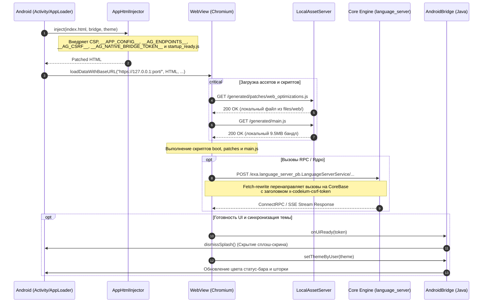

# Веб-интерфейс Antigravity: `web/`

> Одностраничное приложение (SPA на базе React), выполняемое в изолированном Android WebView и взаимодействующее с локальным Go/C++ ядром (`language_server`) через loopback HTTPS и нативный Java-мост (`AndroidBridge`).

---

## 1. Архитектурный обзор (Architecture Overview)

Веб-слой Antigravity представляет собой специализированный UI-фронтенд, упакованный в ассеты приложения и оптимизированный для работы на сенсорных экранах Android (ARM64). Вместо загрузки через классическую схему `file:///android_asset/` (блокирующую современные возможности браузера и работу ConnectRPC), интерфейс монтируется в `WebView` через `loadDataWithBaseURL` на доверенный origin loopback-сервера `https://127.0.0.1:<port>/`.

### Архитектурная диаграмма взаимодействий



---

## 2. Структура файлов и каталогов

```
web/
├── build.sh                      # Баш-оркестратор сборщика фрагментов и патчера
├── src.manifest                  # Декларативный манифест сборки web/generated/**
├── patch_main.py                 # Патчер upstream main.js (Desktop Mode, поиск диалогов и универсальный поиск)
├── index.html                    # Корневой HTML-шаблон хоста приложения
├── main.js                       # Исходный (upstream) обфусцированный бандл React UI (~9.9 МБ)
├── jetbox.css                    # Стили специфичных контролов и терминала
├── compiled_tailwind.css         # Базовый скомпилированный бандл Tailwind CSS
├── prism_bundle.js               # Бандл подсветки синтаксиса PrismJS (defer)
├── diff_worker.js                # Web Worker для фонового вычисления строковых диффов
├── audio_processor.js            # AudioWorkletProcessor для потокового аудио 16 kHz
├── antigravity-icon.png          # Иконка приложения
├── google_signin.svg             # Векторный ассет кнопки входа
├── symbols-icons/                # Локальный кэш иконок Material Symbols
├── workers/                      # Модули интеграции с PDF.js
│   ├── pdf.min.mjs               # Библиотека PDF.js core
│   ├── pdf.worker.mjs            # Воркер парсинга PDF
│   └── pdfjs_loader.mjs          # Мост между Closure compiler и ESM PDF.js
├── generated/                    # Каталог артефактов сборки (генерируется build.sh)
│   ├── main.js                   # Пропатченный рабочий бандл приложения
│   ├── bridge.core.js            # Ядро моста, полифиллы и рерайтер fetch
│   ├── boot/                     # Скрипты ранней инициализации (<head>)
│   │   ├── custom-elements-guard.js
│   │   └── theme-bootstrap.js
│   └── patches/                  # Мобильные патчи и адаптеры
│       ├── web_optimizations.js
│       ├── touch_model_menu.js
│       ├── theme_sync.js
│       └── startup_ready.js
├── src/                          # Модульные исходники фрагментов бандлов
│   ├── boot/                     # Фрагменты раннего старта
│   ├── core/                     # Фрагменты ядра моста (namespace, csrf, fetch, ...)
│   └── patches/                  # Фрагменты функциональных патчей
└── tests/
    └── selftest.sh               # Тест сборки и проверки целостности исходников
```

---

## 3. Конвейер сборки бандлов (Bundling Pipeline)

Сборка веб-слоя выполняется утилитой [`build.sh`](build.sh) на основе манифеста [`src.manifest`](src.manifest). Пайплайн спроектирован так, чтобы гарантировать **неизменность апстримного файла `main.js`**: все изменения вносятся исключительно в копию в `web/generated/main.js`.

### Синтаксис `src.manifest`
- `bundle iife <path>` — объявляет бандл с оборачиванием в изолированную IIFE `(function(){ ... })();`. Если исходные фрагменты бандла уже имеют собственное замыкание верхнего уровня, `build.sh` автоматически пропускает повторную обертку, предотвращая появление вложенных `(function(){(function(){...})()})();`.
- `bundle <path>` — объявляет бандл с прямой конкатенацией без замыкания.
- `src/<path>` — добавляет фрагмент кода в текущий открытый бандл.
- Строки `#` и `;` считаются комментариями.

### Генерируемые бандлы

| Бандл (`web/generated/...`) | Режим | Размер | Назначение |
|---|---|---|---|
| **`boot/custom-elements-guard.js`** | IIFE | ~514 B | Предотвращает краш при повторной регистрации Custom Elements в overlay-бандлах. |
| **`boot/theme-bootstrap.js`** | IIFE | ~1.3 KB | Мгновенно применяет `light`/`dark` до первого рендера, предотвращая мигание экрана. |
| **`bridge.core.js`** | IIFE | ~12 KB | Полифилл `window.process`, конфигурация, CSRF, discovery эндпоинтов и перехватчик `fetch`. |
| **`patches/web_optimizations.js`** | IIFE | ~2.2 KB | Ликвидация 300мс задержки тапа, фиксация высоты `--agy-vvh` при открытии IME, GPU-композитинг. |
| **`patches/touch_model_menu.js`** | IIFE | ~6.7 KB | Адаптация hover-меню выбора моделей Base UI под сенсорный ввод. |
| **`patches/theme_sync.js`** | IIFE | ~4.7 KB | MutationObserver за классами `<html>`/`<body>` и передача смены темы в нативный Android. |
| **`patches/startup_ready.js`** | IIFE | ~4.7 KB | Детектор первого полезного рендера DOM и перехватчик JS-ошибок для `AndroidBridge`. |
| **`main.js`** | Raw + Patch | ~9.5 MB | Рабочий бандл React UI, пропатченный скриптом `patch_main.py`. |

### Проверка валидности (Verification)
После сборки `build.sh` запускает статический синтаксический анализатор V8 (`node --check`) для каждого сгенерированного файла. Если Node.js не установлен в окружении, проверка пропускается с информационным предупреждением.

---

## 4. Патчинг основного бандла (`patch_main.py`)

Скрипт [`patch_main.py`](patch_main.py) выполняет динамическую модификацию скомпилированного и обфусцированного бандла `main.js`:

1. **Идемпотентность**: Перед патчингом проверяется наличие маркеров `"Desktop Mode"`, `"ag_desktop_mode"`, `"conversation-search-button"` и `"onSearchClick"`.
2. **Внедрение Desktop Mode Toggle**:
   - Находится сигнатура хуков компонента Appearance:
     ```python
     hook_pattern = re.compile(r'(var\s+[A-Za-z0-9_$]+=[A-Za-z0-9_$]+!==3,\s*[A-Za-z0-9_$]+=[A-Za-z0-9_$]+!==2,\s*[A-Za-z0-9_$]+=[A-Za-z0-9_$]+=>\s*[A-Za-z0-9_$]+=>\{.*?\};)')
     ```
   - Внедряются React-хуки `useState` и `useCallback`, связывающие состояние с `window.Android.isDesktopMode()` и `localStorage.getItem('ag_desktop_mode')`.
   - Находится вызов `createElement` для секции `{label:"Theme"}` и сразу за ним инжектируется элемент настройки Desktop Mode с переключателем (`Switch`).
3. **Кнопка поиска по диалогу (Conversation Search Button)**:
   - В компонент действий шапки проекта (`k4`) внедряется кнопка поиска (`HeaderButtonIcon` с иконкой `search` и `dataTestId: "conversation-search-button"`), располагающаяся непосредственно слева от трёхточечного меню (`titlebar-more-actions`).
   - Кнопка поддерживает поиск по всему тексту диалога, активируя панель `findInConversation` через Redux-слайс `findInPane` (`setIsFindBarVisible`, `triggerFindFocus`), вызов команды ядра `CommandsService.executeCommand("conversationView.findInConversation")` и эмуляцию клавиатурного сочетания `Ctrl+F`.
   - При повторном клике во время активного фокуса на строке поиска происходит плавное сворачивание панели.
4. **Монохроматизация логотипа Eza**:
   - Upstream-логотип Antigravity содержит жестко зашитый многоцветный SVG (`mask0_6153_71`).
   - Патчер заменяет тело компонента `var Eza=...` на монохромный плоский SVG, использующий CSS-токены `text-[#9AA0A6]` (тёмная тема) и `text-[#5F6368]` (светлая тема).

---

## 5. Взаимодействие с нативным Android (`AndroidBridge`)

Веб-приложение выполняется в WebView, где объект `Android` (а также псевдоним `window.AndroidBridge`) зарегистрирован через `addJavascriptInterface`.

### Инъекции во время загрузки (`AppHtmlInjector`)
Перед передачей разметки в движок WebView, Java-класс `AppHtmlInjector` внедряет в `<head>`:
- **Strict Content Security Policy (CSP)**: запрет небезопасных внешних фреймов и объектов, ограничение `worker-src 'self' blob:`.
- **Глобальные параметры конфигурации**:
  - `window.__APP_CONFIG__` — JSON-параметры среды (версия, платформа, пути к воркспейсу).
  - `window.__AG_ENDPOINTS__` — адрес core-сервера (`core`, `core_http`, `enginePort`).
  - `window.__AG_CSRF__` — криптографический CSRF-токен для авторизации в `language_server`.
  - `window.__AG_HOST_THEME__` / `window.__AG_RESOLVED_THEME__` — начальная тема хоста (`dark` / `light` / `system`).
  - `window.__AG_NATIVE_BRIDGE_TOKEN__` — криптографический 32-байтный одноразовый токен для авторизации привилегированных вызовов (сброс сплэша, сохранение блобов).
- **Скрипт сигнала готовности**: `<script src="./generated/patches/startup_ready.js"></script>`.

### Интерфейсы моста `window.Android`

| Метод | Сигнатура | Назначение |
|---|---|---|
| `onUiReady` | `(token: string) => void` | Вызывается скриптом `startup_ready.js` при первом реальном рендере DOM для скрытия нативного сплэш-экрана. |
| `onUiError` | `(token: string, message: string) => void` | Передает критические фатальные ошибки JS в нативный логкат и экран ошибки. |
| `setThemeByUser`| `(theme: string) => boolean` | Передает выбранную пользователем тему (`light`/`dark`) для обновления цвета системных баров Android. |
| `onVisualThemeChanged` | `(theme: string) => void` | Сигнализирует о смене активного CSS-оформления. |
| `getTheme` | `() => string` | Возвращает текущую системную тему устройства. |
| `isDesktopMode` | `() => boolean` | Проверяет, включен ли режим широкого десктопного Viewport. |
| `setDesktopMode`| `(enabled: boolean) => void` | Динамически переключает User-Agent и Viewport WebView между мобильным и десктопным режимами. |
| `openDirectoryPicker` | `() => void` | Запускает системный диалог выбора папки (SAF Document Tree) для открытия проекта. |
| `saveBlob` | `(token, base64, filename, mime) => void` | Безопасное сохранение сгенерированных веб-интерфейсом блобов в хранилище `Downloads`. |

---

## 6. Подсистемы веб-слоя

### 6.1. Подсистема тем (Theme Engine)
1. **Ранняя стадия (`theme-bootstrap.js`)**: Выполняется синхронно в `<head>`. Читает `?hostTheme=` или `__AG_HOST_THEME__`. Моментально ставит класс `dark`/`light` на `document.documentElement` и задает `style.colorScheme`. Исключает белый блик при запуске в тёмной теме.
2. **Синхронизация во время работы (`theme_sync.js`)**: 
   - `MutationObserver` слушает изменения атрибута `class` на `<html>` и `<body>`.
   - Слушатель `window.addEventListener('storage')` отслеживает смену темы во вкладках.
   - Слушатель `matchMedia('(prefers-color-scheme: dark)')` реагирует на системное расписание день/ночь.
   - Метод `notify()` обновляет нативные шторки и панели Android.

### 6.2. Мобильные оптимизации (Mobile & Touch Optimizations)
- **`web_optimizations.js`**:
  - `touch-action: manipulation` на кнопках, ссылках и инпутах отключает браузерную 300-миллисекундную задержку двойного тапа.
  - `visualViewport.addEventListener('resize')` динамически пересчитывает переменную `--agy-vvh` в пикселях, предотвращая дергание поля чата при выезде клавиатуры IME.
  - Выборочный `transform: translateZ(0)` форсирует GPU-слои только для ключевых контейнеров скролла (`chat-container`, `.scrollable`), предотвращая исчерпание видеопамяти и зависания RenderThread на чипах ARM Mali.
- **`touch_model_menu.js`**:
  - Выпадающий список выбора моделей Antigravity в библиотеке Base UI открывает меню уровней размышления (Low / Medium / High) исключительно по hover-событию мыши.
  - На сенсорном экране тап приводил к мгновенному выбору модели по умолчанию без раскрытия настроек.
  - Патч перехватывает `pointerdown`/`click` в capture-фазе, блокирует событие и симулирует синтетическую цепочку событий указателя (`pointerover`, `pointerenter`, `pointermove`), после чего посылает `KeyboardEvent('ArrowRight')` с задержками 70мс и 260мс, гарантируя открытие мобильного подменю.

### 6.3. Мост ядра и транспорт (Core Transport & Fetch Rewrite)
- **`bridge.core.js`**:
  - Создает стаб `window.process` (Linux / ARM64 / renderer) со стандартными методами `cwd()` и `nextTick()`.
  - Переопределяет `window.fetch`. Все запросы к ConnectRPC-маркерам (`exa.language_server_pb.`, `exa.host_bridge_pb.`, `/exa.`) переписываются на целевой origin ядра `https://127.0.0.1:<enginePort>`.
  - Автоматически инжектирует CSRF-заголовок `x-codeium-csrf-token` и параметр `csrf_token`.
  - Содержит логику ретрая `fetchWithStartupRetry` (до 30 попыток с шагом 120мс), что предотвращает сбои первого запроса, если фронтенд стартовал раньше, чем TLS-сокет ядра завершил биндинг.

### 6.4. Воркеры и аудиопроцессинг
- **PDF Pipeline (`workers/`)**: изолированная работа с документами в воркере `pdf.worker.mjs` без блокировки главного потока UI.
- **Diff Calculation (`diff_worker.js`)**: вычисление статистики изменений строк (алгоритм Майерса $O(ND)$ с отсечением совпадающих префиксов и суффиксов) вынесено в Web Worker.

### 6.5. Поиск (Conversation & Universal Search)
- **Поиск в диалоге (`conversation-search-button`)**:
  - Расположен слева от кнопки с тремя точками (`more_vert`) в заголовке `k4`.
  - Открывает панель `FindBar` (`isFindBarVisible`) с поддержкой трех переключателей (Match Case `Aa`, Match Whole Word `ab`, Use Regular Expression `.*`).
  - **Сенсорные оптимизации переключателей**: кнопки переключателей снабжены обработчиками `onPointerDown` с блокировкой перехвата фокуса и схлопывания экранной клавиатуры, увеличенной областью тапа (`min-w-[24px] min-h-[22px]`) и контрастной индикацией активного состояния (`bg-primary text-primary-foreground font-bold shadow-xs`).
  - **Полнотекстовый поиск по ответам и пользовательским запросам**: устранено отсечение пользовательских реплик функцией `sC(a, b)`, вызванное мобильным классом `select-none` в контейнере `lifted-context-menu-trigger`. В селектор добавлены исключения для `[data-quotable]`, `[data-testid="user-input-step"]`, `[aria-label="User message"]` и класс `select-text` в `bwb`, что позволяет искать как в ответах ассистента, так и в пользовательских сообщениях.
- **Универсальный поиск на главном экране (`main-search-button`) и полнотекстовый поиск по всем диалогам**:
  - Добавлена кнопка поиска с иконкой `search` в шапку главного экрана (`fRb`) рядом с кнопками настроек и обновления.
  - В конфигурации активирован флаг `conversationSearchV2: {feature: true}` и разблокирован `showUnifiedSearch` в командной палитре (`PBb`), открывая универсальный поиск `"Search conversations, commands, and code..."`.
  - **Нативный полнотекстовый мост (`window.Android.searchConversations`)**: на Android языковой сервер не индексирует стенограммы локальных диалогов. Реализован высокоскоростной нативный поиск в `AndroidBridge.java`: сканирование базы `conversation_summaries.db` и файлов стенограмм `transcript.jsonl` в директории `brain/` за <10мс. Функция возвращает совпадения с контекстными сниппетами и точными границами подсветки (`snippetMatchRanges`).
  - **Мгновенный переход**: выбор любого результата в поиске или клик по системному уведомлению вызывает `window.__agyOpenConversation(cascadeId)` / `Nsb()(cascadeId)`, мгновенно открывая соответствующий чат диалога в проекте.

### 6.6. Категории системных уведомлений (Notification Categories)
Интегрированы три нативных канала уведомлений Android с поддержкой всплывающих (floating/heads-up) оповещений, параллельной обработки нескольких диалогов и перехода к чату по клику:
1. **Agent completed in the open chat** (`agent_completed_open_chat`):
   - Описание: *Completion in the open chat: notification shade without a heads-up banner*
   - Важность: `IMPORTANCE_DEFAULT`. Отображается в шторке уведомлений без всплывающего баннера, когда окно чата активно.
2. **Agent completed** (`agent_completed`):
   - Описание: *Agent finished or needs attention*
   - Важность: `IMPORTANCE_HIGH` (приоритет `PRIORITY_MAX`, defaults `DEFAULT_ALL`, вибрация). Полноценное всплывающее (floating heads-up banner) уведомление на экране при завершении задачи ассистентом или ожидании ответа пользователя (вопросы, подтверждение действий).
3. **Agent progress** (`agent_progress`):
   - Описание: *Silent progress for Antigravity tasks*
   - Важность: `IMPORTANCE_LOW`. Бесшумное постоянное (ongoing) уведомление с отображением реального прогресса (`Step N: <активность>...`) для фоновых задач ассистента.
- **Поддержка нескольких одновременных диалогов**: каждому диалогу присваивается уникальный тег (`cascade_prog_<id>` / `cascade_done_<id>`) и стабильный числовой ID, благодаря чему несколько параллельных задач отображают отдельные карточки прогресса в шторке.
- **Переход по клику**: каждое уведомление содержит явный `PendingIntent` с `cascade_id`. При нажатии на уведомление `MainActivity` перехватывает событие (включая `onNewIntent`) и переключает WebView на нужный диалог.

---

## 7. Результаты аудита: архитектурные костыли и рекомендации

В ходе аудита веб-слоя выявлен ряд архитектурных нюансов, узких мест и костылей:

| Проблема / Костыль | Локация | Описание риска | Рекомендация по исправлению |
|---|---|---|---|
| **Отсутствие авто-сборки веб-слоя в пайплайне APK** | `modules/builder/05_stage_assets.py` | Скрипт `05_stage_assets.py` проверял и собирал `env`, но для `web/` просто копировал существующий `web/generated/`. Если разработчик правил `web/src/**` и не запустил `web/build.sh` вручную, в APK попадал устаревший бандл. | **[Исправлено]** В `05_stage_assets.py` добавлен автоматический вызов `bash web/build.sh` перед стадированием ассетов. |
| **Утечка `src.manifest` в финальный релизный APK** | `modules/builder/05_stage_assets.py` | В списке игнорируемых файлов `web_ignore` отсутствовал `src.manifest`, из-за чего исходный манифест сборщика попадал в ресурсы продакшн-APK. | **[Исправлено]** `"src.manifest"` добавлен в кортеж исключений `web_ignore`. |
| **Хрупкий Regex-патчинг `main.js`** | `web/patch_main.py` | Патчер завязан на точные сигнатуры обфусцированных переменных React (`var C=g!==3,D=g!==2...`) и содержит захардкоженные запасные имена компонентов (`item_comp="v3"`, `switch_comp="dX"`). При смене версии бандла возможен сбой инъекции или `ReferenceError`. | Реализовать верификацию синтаксиса через AST-парсер либо добавить строгие тесты проверки наличия интерфейса в CI. |
| **Избыточная двойная обертка IIFE** | `web/src.manifest`, `src/boot/theme-bootstrap.js` | Исходник `theme-bootstrap.js` уже имеет собственное замыкание `(function(){...})()`, а в манифесте объявлен как `bundle iife`. В итоге генерировался двойной вложенный IIFE. | **[Исправлено]** В `web/build.sh` добавлена проверка `is_already_iife`, предотвращающая повторное оборачивание уже закрытых фрагментов. |
| **Зависимость от `/tmp` на Android** | `web/build.sh` (строка 28) | Вызов `mktemp "${TMPDIR:-/tmp}/..."` падал на Android при отсутствии `$TMPDIR` в окружении, так как каталога `/tmp` в системе нет. | **[Исправлено]** Заменено на переносимый и безопасный путь `${TMPDIR:-${HOME:-.}/.tmp}` с автоматическим созданием каталога. |
| **Захардкоженный fallback CSRF** | `web/src/core/csrf.js` (строка 13) | Если токен не передан через `__AG_CSRF__` и отсутствует в DOM, используется константа `'agy-standalone-token'`. | Генерировать случайный UUID/Hex fallback-токен при инициализации вместо статической константы. |
| **Несогласованность схемы порта в discovery** | `web/src/core/endpoints.js` (строка 50) | При парсинге URL-параметра `?port=` выставляется `ENDPOINTS.core_http = 'http://127.0.0.1:' + port;`, хотя ядро работает исключительно по HTTPS. | Заменить схему на `https://127.0.0.1:` для единообразия с TLS-транспортом. |
| **Эмуляция событий тача через задержки** | `web/src/patches/touch_model_menu/` | Раскрытие меню моделей опирается на последовательность `setTimeout(..., 70)` и `setTimeout(..., 260)`. При сильной загрузке CPU задержки могут не успеть сработать. | Использовать MutationObserver или события смены фокуса для подтверждения открытия подменю. |

---

## 8. Проверка и тестирование (Verification)

Для проверки целостности и собираемости веб-слоя запустите тест самодиагностики:

```bash
bash web/tests/selftest.sh
```

Тест выполняет:
1. Создание изолированной временной копии директории `web/`.
2. Фиксацию контрольной суммы SHA-256 исходного `main.js`.
3. Запуск сборки `web/build.sh` и патчера `patch_main.py`.
4. Проверку, что исходный `main.js` остался неизменным.
5. Проверку генерации всех файлов и валидность путей в `index.html`.
6. Верификацию отсутствия повторных IIFE-оберток в сгенерированных бандлах.
